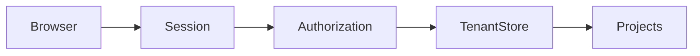

# TenantDesk

**A client portal with server-side tenant isolation you can test directly.**

[](https://github.com/ashutosh0sharma1/tenantdesk/actions/workflows/ci.yml)

## What you can do

Next.js project/download routes, HttpOnly sessions, origin checks and direct API denial tests.

## How it works



## Quick start

```sh
npm ci
npm run dev
# Open http://127.0.0.1:8808; use the labeled demo accounts.
```

## Verify

```sh
npm run lint
npm run typecheck
# With the local server running:
npm test
npm run build
```

[VALIDATION.md](VALIDATION.md) records checks actually run against this export and their limits.

## Boundaries

Synthetic demo with known passwords, local JSON project persistence and in-memory sessions. Restart resets sessions. Replace identity, persistence and deployment controls before real customer use.

## Contribute

Start with a small synthetic reproduction. Improvements to portable setup, failure recovery, documentation and regression coverage are welcome. Read [CONTRIBUTING.md](CONTRIBUTING.md) before opening a pull request.

## License and provenance

See [LICENSE](LICENSE) and [THIRD_PARTY_NOTICES.md](THIRD_PARTY_NOTICES.md). This clean source export excludes private data, credentials and development history.

## Try tenant isolation

Use `jamie@northstar.demo`, `sam@meridian.demo`, or `admin@tenantdesk.demo` with the deliberately public demo password `DemoAccess!2026`. The two clients see separate project sets; the administrator sees both. Downloads are generated fictional text/CSV, never local user files.

Projects persist in ignored `.data/tenantdesk.json`; sessions and rate limits live in memory and reset on restart. For a custom local origin, set `TENANTDESK_ORIGIN` to its exact URL. The default accepts localhost on port 8808 only.

Run `npm run build && npm run test:integration` to launch an isolated server on a temporary port, run all route checks and stop it. `npm test` instead targets an already running server via `TEST_BASE_URL`.
